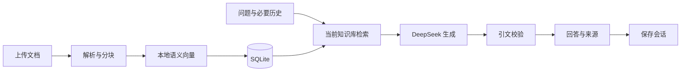

# 架构说明

知微使用 Flask 提供 API，原生 HTML、CSS 和 JavaScript 构建界面，SQLite 保存用户、文档、向量和会话。默认由本机 Ollama 的 `qwen3-embedding:0.6b` 生成语义向量，DeepSeek Flash 生成回答；安装和配置见[项目说明](../README.md)。

## 主要模块

| 文件 | 职责 |
| --- | --- |
| `backend/__init__.py` | API、登录、资源权限、文档与会话持久化 |
| `backend/documents.py` | PDF、Markdown、TXT 解析与分块 |
| `backend/vector_store.py` | 语义检索、TF-IDF 回退和检索扩展接口 |
| `backend/rag.py` | 追问改写、证据组织、生成与引用校验 |
| `backend/providers.py` | 模型服务调用、连接检查和向量验证 |
| `backend/chatgpt_auth.py` | 可选 ChatGPT 会员接入的授权与凭据管理 |
| `frontend/` | 知识库、资料、问答、来源和模型选择界面 |

## 文档与问答流程

上传后先保存原件和文本，再生成向量。文本按约 750 字符分块、重叠约 120 字符，并保留文档、页码或行号。每个片段记录向量、模型指纹和索引状态；嵌入失败时原文仍可保留，恢复服务后可重建索引。更换嵌入模型需要重建，切换回答模型无需重建。

提问只检索当前账户、当前知识库的片段。语义检索使用归一化余弦相似度，最多返回 6 个片段，每份文档最多 3 个。指代追问可使用近期历史改写；明确的文章概览使用目标文档开头最多 4 个片段，并提示覆盖范围。

模型返回结论与证据，后端验证引用编号及原文引文。仅空白排版不同的引文可映射回原文，文字、数字或标点变动不予通过。资料不足时拒答；向量服务失败可回退词法检索，生成或校验失败则显示原文摘录。检索方式、回答模式和原因随会话保存。

## 账户、模型与数据

密码使用带盐哈希，资源访问由后端按账户检查。DeepSeek 模型选择按账户保存；每次请求固定模型配置，追问改写和生成使用同一模型。切换后旧连接检查失效，成功回答保留当次模型标签。

默认嵌入在本机完成；DeepSeek 会收到问题、检索片段和必要历史。部署内各账户共用本地配置的 API 密钥和额度。密钥不返回前端，`.env`、`data/` 和模型文件不提交 Git。备份前先停止服务，再复制 `data/`。

## 当前边界

支持可提取文字的 PDF、Markdown 和 TXT，每批最多 10 份、每份 20 MiB；不包含 OCR。向量保存在 SQLite，`VectorStore.search` 预留替换入口，尚未接入 Chroma。当前面向本机小规模使用，未做生产并发评测；引用真实也仍需核对结论是否被原文支持。
