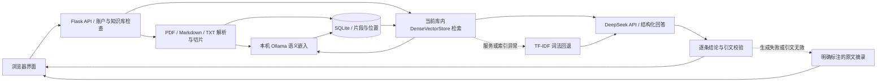

# 实现架构与维护说明

## 运行方案与数据流

V1.3默认配置为 DeepSeek API 的 `deepseek-flash` 生成回答，加本机 Ollama 的 `qwen3-embedding:0.6b` 生成语义向量。原生 HTML/CSS/JavaScript 前端调用 Flask API；SQLite 保存用户、知识库、文档、片段、向量和会话，上传原件保存在本机。前端无需 Node.js 构建。DeepSeek密钥待用户本地填写，当前只有适配模拟回归，真实链路待验收。

```dotenv
RAG_PROVIDER=deepseek
DEEPSEEK_BASE_URL=https://api.deepseek.com
DEEPSEEK_MODEL=deepseek-flash
DEEPSEEK_API_KEY=
EMBEDDING_PROVIDER=ollama
OLLAMA_EMBED_MODEL=qwen3-embedding:0.6b
```

DeepSeek使用独立的 `DEEPSEEK_*` 配置，不从其他提供方密钥回退。密钥仅保存在本地 `.env`；留空时生成不可用，界面应明确提示并允许使用原文摘录。



除默认DeepSeek，还保留 ChatGPT 会员、Ollama 本地生成和其他兼容 API 接入。`RAG_PROVIDER=local` 明确选择离线词法摘录，不进行生成或嵌入模型调用；这不是完整生成式 RAG。配置入口及安装方式以 [根目录 README](../README.md) 和 `.env.example` 为准。

## 账户与授权边界

知微账户使用签名会话 Cookie，密码保存为带盐哈希。资源操作先检查所属用户和知识库，检索结果还须回到本次库内片段集合核对；前端隐藏按钮不能代替后端授权。

默认DeepSeek使用部署者在本机配置的API密钥，独立于知微账户登录；不同知微账户的数据隔离仍由后端执行，API用量来自同一部署密钥。前端只读取配置和检查状态，不接收密钥。`.env`是本地配置文件，不自动加密。

选择可选ChatGPT接入时，会员授权与知微登录为两个步骤。该方式使用 OAuth、PKCE 和 ID-token 校验，凭据在 Windows 下由 DPAPI 加密并按知微账户隔离，支持切换、重授权与断开。此保护针对会员凭据，不能表述为DeepSeek密钥已用DPAPI加密。

“已配置”“模型检查通过”“文档索引就绪”表示不同状态；可选会员还有账户授权状态。普通状态读取不执行推理；主动模型检查执行实际生成与嵌入探测，DeepSeek探测和回答会使用API额度。缓存检查结果不能保证下一次成功，以每条回答及文档的实际状态为准。

## 文档、向量与检索

支持 PDF、Markdown（`.md`）和 TXT；每批最多 10 份，每份最多 20 MiB。PDF 必须含可提取文字，未集成 OCR。文本按约 750 字符切片、重叠约 120 字符，保存文档、页码或行号供引用定位；同一知识库按内容判重。

上传先保存原件与片段，再生成向量。SQLite 同时保存向量、模型指纹、索引状态和错误信息；原文保存成功不代表索引成功。文档显示 `ready`、`partial`、`pending` 或 `error`，知识库可重建索引。指纹包含服务、地址、模型名和可选修订号；更换模型或同名模型内容变化后应重建，避免混用不同向量空间。

`DenseVectorStore` 对当前库的就绪向量进行归一化余弦检索，并限制单文档占用的结果数量，为跨文档证据保留空间。本次实测 `qwen3-embedding:0.6b` 返回 1024 维向量。当前实现是 SQLite 持久化加进程内检索，没有部署 Chroma，也没有大规模近似最近邻索引。

语义服务异常时可回退 `LocalTfidfStore`，使用持久化词频、英文词及中文双字特征做词法检索，并显示降级提示。语义索引只完成一部分时，界面提示本次只覆盖已就绪片段。`VectorStore.search` 保留检索实现的替换入口；未来接入 Chroma 仍须实现索引增删、用户/库过滤、持久化及相同引用元数据。

## 多轮问答、引文与降级

系统识别指代或省略式追问，用有限的近期历史改写检索问题；改写失败时使用会话关键词，并告知用户。生成模型收到当前问题、检索片段和必要历史，返回结构化结论及证据。每条结论必须关联本次检索中的片段，逐字引文必须存在于对应原文；无效结构或证据不会作为生成答案展示。

消息持久化实际状态：`mode` 区分 `llm`、`extractive`、`extractive-fallback`、`refusal`；`retrieval_mode` 区分 `dense` 与 `lexical`；`generation_status` 记录校验、拒答或降级结果。因此，使用词法回退的 AI 回答与使用语义检索的 AI 回答可以分别识别，摘录也不会伪装成生成成功。

资料不足时拒答。生成失败或引文校验失败时返回可核对的原文摘录和明确提示。删除文档后，其片段与向量退出后续检索；历史答案可保留当时的文字快照，来源入口可能已不可用。

逐字引文校验只能验证引文确实来自片段，不能证明模型的概括被原文充分支持。模型仍可能误读、遗漏或过度推断；上传文档本身也可能错误。引用是核对入口，不是零幻觉保证。

## 数据去向与维护限制

默认方案中，文档向量化在本机完成；DeepSeek问答及追问改写会把问题、命中片段和必要历史发送给DeepSeek。改用远程嵌入服务后，待向量化文本也会发送给所配置的服务。仅在选择ChatGPT会员时才使用该会员的生成接入。API密钥与会员授权互相独立，均不应进入前端或Git。

SQLite 和上传原件未做文件级加密。停止服务后备份 `data/` 并限制目录访问；可选会员授权文件仍绑定原 Windows 账户，不是跨电脑免登录凭据。模型文件、用户数据和 `.env` 不应提交仓库。

当前定位是本机、小规模个人资料项目。复杂 PDF、表格、公式和乱码会影响解析与召回；逐库检索尚未进行生产并发或大语料性能评测。自动化通过不代表学生用户研究、检索准确率或性能目标已完成。分层验证结果见 [RAG 修订验收](rag-validation.md)，课堂流程见 [演示说明](demo.md)。
