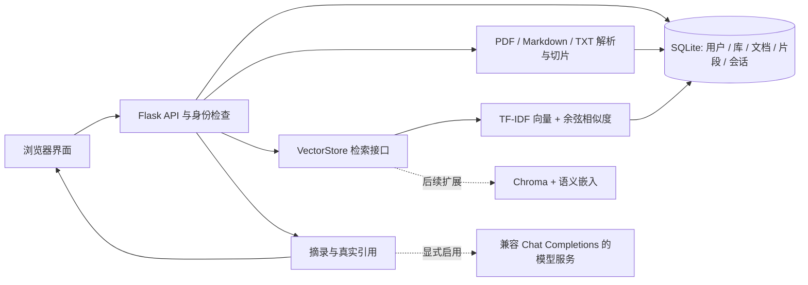

# 实现架构与维护说明

## 数据流

前端以原生 HTML/CSS/JavaScript 完成账号、知识库、批量上传、问答和引用展示；后端用 Flask 提供 JSON API；SQLite 持久化业务数据；本地磁盘保存上传原件。开发启动不依赖 Node.js 构建流程。

## 账号与数据边界

浏览器登录后使用服务端签名的会话 Cookie。密码保存为带盐哈希。每个知识库属于一个用户，文档、文本片段和会话再归属于知识库。后端在资源操作前检查所有权，不能仅依赖前端隐藏按钮。

SQLite 数据文件和上传目录属于应用本地运行账户，不是加密保险箱。同一台计算机上能读取数据目录的系统用户仍可能接触文档。备份应同时覆盖数据库和上传文件，并限制目录访问权限。

## 文档与索引

PDF 通过文本提取器提取文本；Markdown/TXT 按文本编码读取。只有可提取文本的 PDF 可用，扫描件不会自动 OCR。文本经清理后拆成有限长度的片段，并保存文件、页码或位置等信息用于溯源。重复资料按内容判定，解析失败不应留下可被问答使用的空片段。

默认检索将问题和片段转换为 TF-IDF 向量，再以余弦相似度取相关片段。上传后持久化原文片段和词项计数稀疏向量（`token_counts_json`）；问答时根据当前库的文档频率计算 IDF 权重，再进行相似度排序。这样新增和删除立即生效，也意味着大资料库仍有逐次计算语料权重的开销。它不是独立部署的向量数据库。

TF-IDF 是词法检索：它依赖词项或字符特征重合，不具备大型嵌入模型的语义理解能力。当前分词采用英文单词和中文双字特征。检索排序和阈值会影响召回；无证据拒答不能替代系统的召回质量评测。

检索通过 `VectorStore.search` 统一接口调用，可用应用配置 `VECTOR_STORE` 注入实现该接口的实例，使业务路由与具体向量后端分离。Chroma 是预留升级点，不是当前默认运行依赖。后续接入时，需要实现索引增删、用户/知识库过滤、持久化和相同的引用元数据，再运行权限与回归测试；不可只替换相似度计算而遗漏租户隔离。

## 问答与引用

默认本地模式根据检索到的片段组织资料摘录，便于在无 API Key、无外网时运行完整闭环。它不等同于大语言模型生成的综合回答。界面会标识实际模式。

配置模型后，后端可将检索片段和必要的会话上下文提交给兼容接口生成回答。检索范围仍限于当前用户、当前知识库；多轮追问使用会话上下文帮助检索。回答只应引用本次检索提供的片段；模型输出错误或引用校验失败时回退摘录。

引用是证据入口，不是真实性证明。即使编号有效，模型仍可能误读、遗漏或夸大来源；文档本身也可能包含错误或提示注入文本。应把上传内容视为数据、限制指令作用范围并保留人工核对。系统没有“绝对杜绝幻觉”的能力。

## 外部模型配置与隐私

实际环境变量和启动方式见项目根目录 README 与 `.env.example`。默认模型地址、模型名和密钥均为空；只有 `AI_API_KEY`、`AI_BASE_URL`、`AI_MODEL` 三项均填写时才启用外部模型，配置不完整时保持本地模式。启用外部模型意味着检索片段、用户问题及必要对话上下文可能发送到所配置的服务商；不是“所有资料绝不会离开本机”。请仅在有资料处理授权时启用，并核对服务地址和数据条款。API Key 不应放入前端、提交到仓库或出现在截图中。

外部服务不可用、超时或返回不符合要求的结果时，系统回到本地资料摘录，保留可核对的来源。网络与服务端错误不能让整个资料管理流程不可用。

## 维护与局限

- 本地单进程课堂项目适合小规模个人资料；未承诺大规模并发、生产级 SLA 或完整安全认证。
- PDF 阅读顺序取决于原文件；双栏、表格、公式和乱码可能降低检索质量。
- 删除文档后，新的检索不再使用该文档；历史答案可能保留当时的文字快照，但原文入口可能失效。
- 为索引和模型替换增加测试时，应关注账号隔离、知识库过滤、引用真实性和异常降级，不能只测“返回了一段文字”。
- 不应将自动化测试通过写成学生用户体验、检索准确率或性能目标已完成；这些需要各自的评测记录。

自动化测试使用临时数据目录，不污染实际使用数据。运行方式和课程演示参见 `demo.md`。
